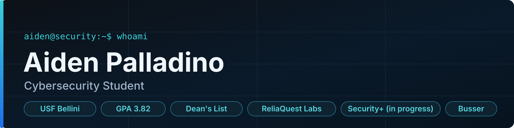

  

  
  
  

Cybersecurity student at USF (Bellini College), graduating December 2027. Interested in SOC work and threat detection, and open to cybersecurity internships.

## Projects

- [AWS Labs](https://github.com/AidenPalladino/aws-labs): three AWS Academy labs: building a VPC with a web server, restricting access with security groups and NACLs, and alerting on account activity with CloudTrail and CloudWatch
- **Detection Labs** — SSH brute-force detection validated against a live Hydra attack, a Suricata IDS with a custom rule tested on my own traffic, and a SHA-256 file integrity monitor: [SSH Brute-Force Detector](https://github.com/AidenPalladino/ssh-bruteforce-detector) &middot; [Suricata IDS Lab](https://github.com/AidenPalladino/suricata-ids-lab) &middot; [File Integrity Monitor](https://github.com/AidenPalladino/file-integrity-monitor)
- [HTB Write-ups](https://github.com/AidenPalladino/HTB-Writeups): Hack The Box machine and Academy module write-ups

## Other

- USF Hack The Box CTF (Spring 2026): solved 7 challenges with a 3-person team
- ReliaQuest Security Operations Labs (Fall 2026)
- Completed Deloitte's Cyber Job Simulation (Forage)
- Studying for CompTIA Security+
- Member of Whitehatters, USF's security club
